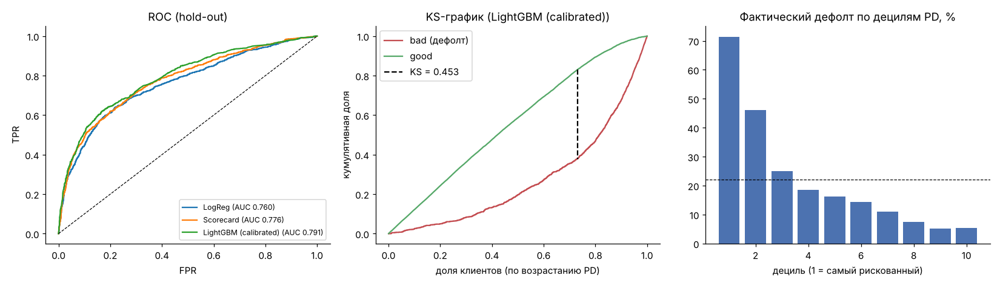
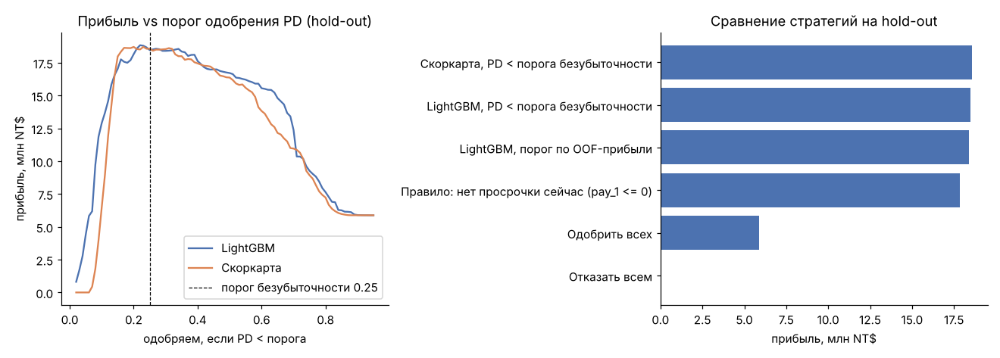

# Credit Default Scoring

  

An end-to-end credit risk project: from raw data to a calibrated probability-of-default (PD) model, an interpretable WoE scorecard with decline reason codes, a profit-based approval policy, a fairness audit and a small scoring app.

**Task.** Given six months of payment history for a credit-card client, estimate the probability of default in the next month and turn it into an approve / decline decision.

**Data.** [UCI Default of Credit Card Clients](https://archive.ics.uci.edu/dataset/350/default+of+credit+card+clients) (Taiwan, 2005): 23,976 clients after removing 24 exact duplicates, 22.1% defaults. Stratified split: 19,180 train / 4,796 hold-out.

---

## Results

Hold-out set, evaluated once after model selection on the training folds.

| Model | ROC-AUC | Gini | KS | PR-AUC | Brier |
|---|---|---|---|---|---|
| Logistic regression | 0.760 | 0.520 | 0.421 | 0.520 | 0.139 |
| WoE scorecard (interpretable) | 0.776 | 0.552 | 0.420 | 0.543 | 0.136 |
| **LightGBM, tuned and calibrated** | **0.791** | **0.582** | **0.452** | **0.570** | **0.132** |

5-fold cross-validated ROC-AUC of the tuned LightGBM on the training set: 0.783 (std 0.008).

- **Ranking.** The riskiest 10% of clients (by PD) default at 71.5% (lift 3.2). The riskiest 20% contain 53% of all defaults.
- **Approval policy.** A client is approved when `PD < r / (r + LGD)`, i.e. when the expected profit is positive (0.25 for the assumed r = 0.20 and LGD = 0.60). On the hold-out set:

  | Strategy | Approval rate | Default rate among approved | Profit, NT$ M |
  |---|---|---|---|
  | Decline everyone | 0% | - | 0.00 |
  | Approve everyone | 100% | 22.1% | 5.88 |
  | Rule: no current delay (`pay_1 <= 0`) | 77.7% | 13.9% | 17.85 |
  | WoE scorecard, PD < 0.25 | 76.4% | 12.9% | 18.57 |
  | **LightGBM, PD < 0.25** | 73.9% | 11.7% | 18.47 |

  The model beats the simple delinquency rule by about +0.61M NT$ (+3.4%); the 95% bootstrap interval of the difference is +0.05M to +1.20M. The gap widens when losses are higher (r = 0.10, LGD = 0.80: model +4.2M, rule -0.8M). Profit figures depend on assumed economic parameters, see [Limitations](#limitations).
- **Fairness.** Sex and marital status are not model features (adding them changes ROC-AUC from 0.7899 to 0.7901). The audit of decisions gives approval-rate ratios of 0.95 across sex and 0.87 across age groups (rule of thumb: at least 0.80). The 45+ group has the lowest approval rate and should be reviewed.




### Where to find the results

| What | Where |
|---|---|
| Full write-up: EDA, models, economics, fairness, limitations (Russian) | [`reports/report.md`](reports/report.md) |
| Every metric as machine-readable JSON (CV, hold-out, deciles, PSI, SHAP ranking, profit by strategy, sensitivity grid, bootstrap, fairness) | [`reports/metrics.json`](reports/metrics.json) |
| Figures: EDA, ROC / KS / deciles, calibration, SHAP, information value, profit, fairness | [`reports/figures/`](reports/figures) |
| Scorecard: bins, WoE, points per bin | [`reports/scorecard_table.csv`](reports/scorecard_table.csv) |
| Hold-out predictions: PD, score, decision, decline reasons for each of 4,796 clients | [`outputs/scored_test_clients.csv`](outputs/scored_test_clients.csv) |
| Executed notebook that walks through all of the above | [`notebooks/credit_scoring.ipynb`](notebooks/credit_scoring.ipynb) |

### How to verify the results

```bash
python verify_results.py      # recomputes AUC, Gini, KS and profit from outputs/scored_test_clients.csv
                              # and compares them with reports/metrics.json (no retraining, takes seconds)
python -m pytest -q tests     # 8 tests: features, WoE, scorecard, business logic, metrics, scoring
python -m creditrisk.pipeline # full retraining (~6 min); random_state is fixed, so metrics.json should be
                              # reproduced up to library-version differences
```

---

## Approach

1. **Features in SQL.** 22 model features are built by a single DuckDB query: maximum delay, number of delayed months, delay trend (last 3 vs first 3 months), utilization (current, average, maximum), over-limit months, payment-to-bill ratio, bill change. Undocumented education and marital codes are merged into "other".
2. **Protected attributes excluded.** `sex` and `marriage` are not used for modelling; they are kept only for the fairness audit.
3. **Models.** Logistic regression (baseline), WoE scorecard, Random Forest and LightGBM, compared on the same 5-fold cross-validation with out-of-fold predictions. LightGBM is tuned by randomized search on ROC-AUC.
4. **Scorecard.** WoE binning with rare-bin merging, selection by Information Value (>= 0.02) and correlation (< 0.8), logistic regression with a sign check on coefficients, points scaled to 600 at 50:1 odds with 20 points to double the odds. Rejected applicants get the top features that cost them the most points (reason codes).
5. **Calibration.** Isotonic calibration of the LightGBM output so that predicted PD can be used in expected-profit formulas.
6. **Decision policy.** Approve if `(1 - PD) * r * E - PD * LGD * E > 0`, which is equivalent to `PD < r / (r + LGD)` and does not depend on the exposure `E`. The result is compared with the empirical optimum found on out-of-fold training predictions, with a rule-based baseline, and with a sensitivity grid over r and LGD.
7. **Fairness audit.** Approval rate, approval rate among good clients, default rate among approved and AUC by sex and age group; disparate-impact ratio.
8. **Stability.** Population Stability Index of the score between train and hold-out (0.001).

### Metrics used
- **ROC-AUC / Gini** (`Gini = 2 * AUC - 1`): ranking quality. **KS**: maximum gap between cumulative shares of defaulters and non-defaulters. **PR-AUC**: quality under class imbalance. **Brier**: accuracy of predicted probabilities.
- **PD**: probability of default. **LGD**: loss given default. **E**: exposure at default. **WoE / IV**: weight of evidence and information value of a binned feature. **PSI**: distribution shift (below 0.1 stable, above 0.25 strong shift).

---

## Quick start

```bash
git clone https://github.com/AmrayevRRtr/credit-default-scoring.git && cd credit-default-scoring
pip install -r requirements.txt            # Python 3.9+

python verify_results.py                   # check the published results
python score.py data/raw/credit_default.csv scored.csv   # score clients with the shipped models
streamlit run app/streamlit_app.py         # web demo
python -m creditrisk.pipeline              # retrain everything, regenerate models, figures and metrics
```

Trained models are included in `models/`. If your scikit-learn / LightGBM versions differ and loading fails, retrain with `python -m creditrisk.pipeline`.

### Scoring example

`score.py` accepts a CSV in the format of the source data (the `default` column is optional) and writes the PD, scorecard points, decision and reasons for decline:

```
client_id,limit_bal,pd,score,decision,decline_reasons
0,20000,0.5812,476.0865,decline,"pay_1, limit_bal, delay_trend"
1,90000,0.077,550.4182,approve,
```

The same is available from Python:

```python
import pandas as pd
from creditrisk.business import LendingAssumptions
from creditrisk.scoring import score_clients

res = score_clients(pd.read_csv("new_clients.csv"), LendingAssumptions(interest_rate=0.20, lgd=0.60))
```

## Project structure

```
creditrisk/
  data.py          loading, cleaning, SQL feature engineering
  woe.py           WoE binning and scorecard (points, reason codes)
  pipeline.py      training, validation, calibration, policy, fairness, artifacts
  evaluation.py    ROC-AUC, Gini, KS, PR-AUC, Brier, PSI, decile table
  business.py      break-even threshold, realized profit, strategies, sensitivity
  fairness.py      group audit and disparate impact
  scoring.py       scoring of new clients
app/streamlit_app.py   demo with per-client breakdown
score.py               command-line scoring
verify_results.py      recomputes the headline results from saved predictions
tests/                 unit and integration tests
data/raw/              source data (see data/README.md)
models/                trained PD model and scorecard
reports/               report, metrics.json, scorecard table, figures
outputs/               hold-out predictions
notebooks/             executed notebook
```

## Limitations

- The data are from one Taiwanese bank in 2005 with a one-month horizon and no timestamps, so the split is random rather than out-of-time; real performance would likely be lower.
- No reject inference: only clients who were granted a card are observed.
- The economic parameters (interest `r = 0.20`, `LGD = 0.60`, exposure approximated by the average 6-month bill capped at the limit) are assumptions, not bank data. Profit figures illustrate the method and should not be read as an expected business effect.
- The simple delinquency rule already captures most of the achievable profit; the model's gain over it is modest at the baseline assumptions.
- The fairness audit is a statistical check on a single dataset, not a legal assessment; the use of age in credit decisions is restricted in some jurisdictions.
- Not a production credit policy: no out-of-time validation, drift monitoring, model documentation or independent validation.

## Data and license

Source: Yeh, I.C. and Lien, C.H. (2009), "The comparisons of data mining techniques for the predictive accuracy of probability of default of credit card clients", *Expert Systems with Applications* 36(2); dataset licensed CC BY 4.0. The file in `data/raw/` is the 24,000-row copy distributed with the [PyCaret datasets](https://github.com/pycaret/datasets). Code is released under the MIT license.
